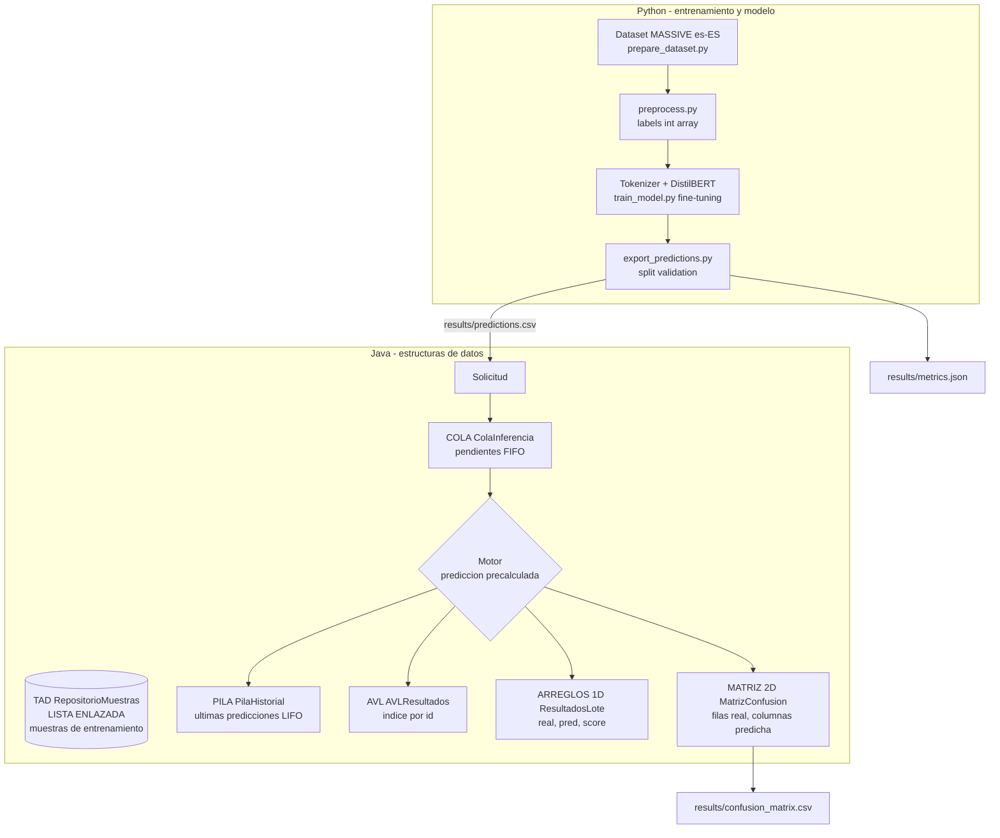

# Arquitectura de TransformerDS

**Track D:** MASSIVE (español, es-ES), clasificación de intenciones.
**Modelo base:** `distilbert-base-multilingual-cased` (ligero, multilingüe, entrenable en CPU).
**Principio:** el Transformer resuelve la clasificación; las estructuras de datos
(en Java, con nodos propios) organizan el sistema alrededor del modelo.

## Diagrama del pipeline



## Dónde está cada estructura

| Estructura | Clase | Rol en el sistema | Archivo de pruebas |
|---|---|---|---|
| TAD + lista enlazada | `RepositorioMuestras`, `Nodo`, `Muestra` | Carga y administra las muestras del dataset (insertar, buscar, eliminar, recorrer) | `PruebasRepositorioMuestras` |
| Cola | `ColaInferencia`, `Solicitud` | Solicitudes pendientes; se atienden en orden de llegada | `PruebasColaPila` |
| Pila | `PilaHistorial`, `Prediccion` | Historial: la última predicción queda arriba | `PruebasColaPila` |
| AVL (y ABB de referencia) | `AVLResultados`, `ABBResultados`, `NodoArbol` | Índice de resultados por id de solicitud, búsqueda en O(log n) | `PruebasArboles` |
| Arreglos 1D | `ResultadosLote`, etiquetas `String[]` | `real[]`, `pred[]`, `score[]` del lote; histogramas y baja confianza | `PruebasEvaluacion` |
| Matriz 2D | `MatrizConfusion` | `int[k][k]` con accuracy, precision, recall, F1 | `PruebasEvaluacion` |

## Fronteras entre Python y Java

- **Python** maneja tensores, tokenizer y pesos (permitido por la consigna).
- **Java** implementa y evalúa las estructuras. Se comunican por archivos CSV:
  `results/predictions.csv` (columnas `id, utt, intent_real, intent_pred, score`).
- Ventaja: el flujo es reproducible y no depende de que ambos lenguajes corran a la vez.

## Splits (explicación para la rúbrica)

| Split | Uso | Dónde |
|---|---|---|
| `train` (primeras 1000 muestras) | Fine-tuning y repositorio de muestras en Java | `prepare_dataset.py`, `train_model.py` |
| `validation` | Evaluación y matriz de confusión | `export_predictions.py` |
| `test` | Reservado, no se toca durante el desarrollo | - |

Las muestras de validación nunca se usan para entrenar, por eso las métricas no
están infladas.

## Reproducir de punta a punta

```
python python/prepare_dataset.py
python python/preprocess.py
python python/train_model.py
python python/export_predictions.py
# luego ejecutar MiProyecto2026 en NetBeans (F6)
```
